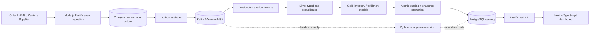

# SupplyGuard 360 — Event-Driven Inventory & Fulfillment Risk Intelligence

**Portfolio-grade reference implementation** for a real retail operations problem: prevent stockouts, detect at-risk delivery promises, and give teams actionable warehouse-level visibility. Designed to demonstrate full-stack engineering **and** Databricks data engineering.

> **Status:** Implemented local demo path + Databricks Lakeflow source and bundle definitions + staged serving export. This is a production-oriented starter, **not a claimed production deployment**. Cloud networking, account resources, alerting, SSO, runtime testing, and SLO validation remain environment-specific.

## Problem / expected business value

Retail teams encounter inventory that appears available but is reserved, late orders hidden in siloed shipping tools, and suppliers whose replenishment ETA is unknown. Manual spreadsheet reconciliation creates delayed decisions. SupplyGuard ingests versioned business events, resolves current state across duplicates/out-of-order arrivals, and highlights critical exceptions.

The goal is **earlier detection**, not an unmeasured claim of savings. In a real pilot, compare *time-to-detect stockout risk*, *late-order visibility lag*, *inventory exception resolution time*, and *preventable cancellation rate* against a control period.

## Architecture



**Why this design?** POST requests do not directly publish Kafka messages: a durable **transactional outbox** prevents the classic database/Kafka dual-write gap. Kafka publishes at least once; consumers are idempotent by `event_id` and track increasing per-entity `sequence`. Databricks writes Delta-backed Medallion layers under Unity Catalog. The API reads from a serving database, not directly from a Spark driver. A PostgreSQL transaction promotes both Gold serving tables together to avoid mixing snapshot generations.

## Your strongest skills used

| Existing engineering skill | Implementation | New data-engineering depth |
|---|---|---|
| React / Next.js / TypeScript | SSR operations dashboard | Consumption of Gold data products |
| Node.js backend | Authenticated Fastify event API, outbox service | Reliable event ingestion |
| Kafka / event-driven systems | At-least-once, stable partition routing | Streaming into managed Lakeflow |
| PostgreSQL | Idempotent state and analytical serving model | Atomic Gold snapshot promotion |
| AWS | Planned MSK + RDS + private connectivity | Databricks on AWS, Unity Catalog |
| Python | Local consumer, synthetic data | PySpark, Spark SQL, Delta Lake, Lakeflow |
| Docker / CI/CD | Local compose, GitHub Actions | Databricks Declarative Automation Bundles |

## Repository tour

```
apps/api/                      Fastify/TypeScript ingest, outbox publisher, read API
apps/web/                      Next.js operational command center
services/local-worker/         Local Kafka -> PostgreSQL preview (not Databricks)
services/seed/                 Deterministic synthetic retailer events
infra/postgres/                Tables, keys, transactional serving + staging
databricks/pipeline.py          Lakeflow Bronze/Silver/Gold
databricks/export_serving.py    Gold snapshot exporter
resources/pipeline.yml         Bundle Lakeflow + refresh job
scripts/check_demo.py          Local smoke checks
.github/workflows/ci.yml       Static checks and tests
```

## Local demo (requires Docker Desktop)

```bash
cp .env.example .env
# IMPORTANT: change DEMO_API_KEY to a >=24-character random string,
# then change POSTGRES_PASSWORD and update DATABASE_URL to match.
docker compose up --build -d
# Check all five services are healthy/running:
docker compose ps
# Seed event streams using Python 3.10+ from your workstation:
export DEMO_API_KEY='the-value-you-set-in-env'
python3 services/seed/seed_demo.py
# Poll the outbox and allow the local worker to process Kafka.
python3 scripts/check_demo.py
```

Open **http://localhost:3000** for the dashboard, `http://localhost:4000/health` for API status.

**Windows PowerShell:** `Copy-Item .env.example .env`; `$env:DEMO_API_KEY='your-secret'`; `python services/seed/seed_demo.py`; `python scripts/check_demo.py`.

- Port 3000: Next.js UI
- Port 4000: Fastify API
- Port 5432: PostgreSQL, loopback only
- Port 19092: Kafka external listener, loopback only

To reset local data entirely: `docker compose down -v` (**destructive**). The initial seed creates 36 SKU/warehouse combinations, 36 supplier updates and 70 orders with shipped/delivered/overdue variations. Re-running the seed is idempotent because event IDs are deterministic.

**Important:** The local stack uses a lightweight Python **preview worker** instead of Databricks so you can demonstrate the same event contracts and risk categories without an account. The cloud pipeline is real Lakeflow source code, but **must be configured and verified in your Databricks workspace**. Do not describe local screenshots as Databricks processing.

## Databricks deployment (AWS account/workspace required)

1. Provision or use a **Unity Catalog-enabled Databricks workspace**, an existing catalog/schema, and a reachable Kafka endpoint (MSK or Confluent). `localhost`, the Docker hostname `redpanda`, and `redpanda:9092` **are not remotely reachable** from Databricks. Set up private routing, firewall rules and broker authentication. If serverless cannot privately reach Kafka in your environment, use an approved classic compute/network design instead.
2. Configure your `databricks` CLI authentication profile (OAuth supported) with least privilege, never commit tokens. Create schema with appropriate permissions for pipeline's service principal.
3. Configure workspace variables either via `--var` flags or bundle target configuration:

```bash
# Examples: replace ALL placeholder hostnames before running.
databricks bundle validate --target dev \
  --var="workspace_host=https://YOUR-WORKSPACE.cloud.databricks.com" \
  --var="catalog=main" --var="schema=supplyguard_dev" \
  --var="kafka_bootstrap=BROKER_PRIVATE_DNS:9092"
databricks bundle deploy --target dev \
  --var="workspace_host=https://YOUR-WORKSPACE.cloud.databricks.com" \
  --var="catalog=main" --var="schema=supplyguard_dev" \
  --var="kafka_bootstrap=BROKER_PRIVATE_DNS:9092"
databricks bundle run supplyguard_refresh --target dev \
  --var="workspace_host=https://YOUR-WORKSPACE.cloud.databricks.com" \
  --var="catalog=main" --var="schema=supplyguard_dev" \
  --var="kafka_bootstrap=BROKER_PRIVATE_DNS:9092"
```

4. Read and query the resulting `bronze_events`, `silver_events`, `gold_inventory_risks`, `gold_order_risks`, `gold_inventory_kpis`, and `gold_replenishment_signals` tables in Unity Catalog. Review Lakeflow expectation metrics before letting invalid records be dropped.
5. Configure `databricks/export_serving.py` as a **downstream job** after successful pipeline refresh, with a Spark session, `psycopg2-binary`, runtime env vars and Databricks secrets. The exporter requires TLS/private access to RDS; use a separate target database from the local preview worker. `docs/cloud-deployment.md` explains promotion and networking. The demo bundle intentionally does **not** schedule the exporter until credentials/networking are configured.

> Kafka auth: the source uses a simple reachable broker endpoint; for SASL/TLS-protected MSK/Confluent, add `kafka.security.protocol`, mechanism and credential configuration through approved secret facilities before production. Do not embed credentials in the bundle YAML.

## API

- `GET /health` — liveness and DB connectivity
- `POST /v1/events` — schema validation, tenant lock, durable outbox; returns `202` or idempotent `200`
- `GET /v1/kpis` — operational counts
- `GET /v1/inventory-risks?limit=100` — prioritised availability risks
- `GET /v1/order-risks?limit=100` — overdue shipment queue

Protected endpoints require `x-api-key`. This is **a single-tenant demo credential only**; see `docs/security-and-operations.md` for the production OIDC/API Gateway plan. Events cannot freely choose a tenant different from the configured tenant.

### Sample event

```json
{
  "version":1,
  "event_id":"d640ef67-d6b7-4793-ae0c-f65ab33c7646",
  "tenant_id":"demo-retailer",
  "event_type":"inventory_snapshot",
  "sequence":12,
  "occurred_at":"2026-10-22T15:00:00Z",
  "payload":{"sku":"SKU-001","warehouse_id":"WH-PUNE","on_hand":20,"reserved":18,"reorder_point":15}
}
```

This yields `available_units = 2`, flagged `LOW_STOCK`. Inventory is a last-write-wins **snapshot** rather than an additive delta, protecting against accidental double subtraction. For each entity+event type, producers must assign **strictly increasing sequence numbers**; no shared global counter is required. A replay of the same event ID is accepted only once downstream.

### Production data definitions

- **STOCKOUT:** `max(on_hand - reserved, 0) = 0`.
- **LOW_STOCK:** available > 0 but below configured reorder point.
- **HEALTHY:** neither above condition.
- **OVERDUE:** not delivered/cancelled and `promised_at < now()`.
- `quantity` does **not** reduce inventory again because `reserved` in WMS snapshots already accounts for it. The actual allocation policy belongs in the transactional warehouse-management system.
- Supplier ETA is for operator context, not a trained ETA prediction. `gold_replenishment_signals` compares a transparent 7-day order run-rate with current days of stock cover and supplier ETA, marking `REPLENISHMENT_GAP` when expected cover expires before replenishment. This is a heuristic, **not** ML forecasting; verify on proper historical data before business use.

## Operational controls (designed, not measured)

| Concern | Implemented | Before real production |
|---|---|---|
| Write durability | Postgres outbox, Kafka acks=-1 | broker replication/retention, outbox lease monitoring |
| Idempotence | Unique event IDs, atomic consumer updates | DLQ, corruption handling, replays |
| Ordering | Per-entity monotonic sequence | explicit upstream guarantees and regression tests |
| Data quality | Lakeflow type/payload expectations, raw audit | alert threshold and managed quarantine |
| Recovery | Kafka offsets, Delta history, replayable Gold | rehearsed disaster recovery and schema migrations |
| Governance | Unity Catalog-compatible models | service principal roles, masking, lineage checks |
| Serving | Atomic cross-table snapshot swap | pagination, replica failover, vacuum and indexes |
| Authorization | local demo API key | OIDC/JWT, scoped tenants, TLS at ingress |
| Observability | health endpoint, logs | lag dashboards, traces, SLO alerts |
| CI | tests and syntax validation | integration tests with real Kafka/Spark and deployment gates |

## Suggested production SLOs (goals, **not measured performance**)

- 99.9% dashboard API monthly availability.
- 99% of source events reflected in Gold within **5 minutes** on configured triggered refresh.
- Zero cross-tenant reads and zero conflicting entity versions in serving tables.
- Critical stockout event to incident alert < 10 minutes (requires alerting integration).

See `docs/security-and-operations.md` for failure modes; `docs/cloud-deployment.md` for cloud deployment phases; and `docs/interview-story.md` for how to present this to Databricks/platform engineering recruiters.

## Useful official documentation

- [Databricks Lakeflow pipelines](https://docs.databricks.com/aws/en/ldp/)
- [Python pipeline decorators](https://docs.databricks.com/aws/en/ldp/developer/python-dev)
- [Lakeflow expectations](https://docs.databricks.com/aws/en/ldp/expectations)
- [Declarative Automation Bundles](https://docs.databricks.com/aws/en/dev-tools/bundles/)
- [Unity Catalog best practices](https://docs.databricks.com/aws/en/data-governance/unity-catalog/best-practices/)

This project uses **synthetic** data and is not affiliated with any retailer.
